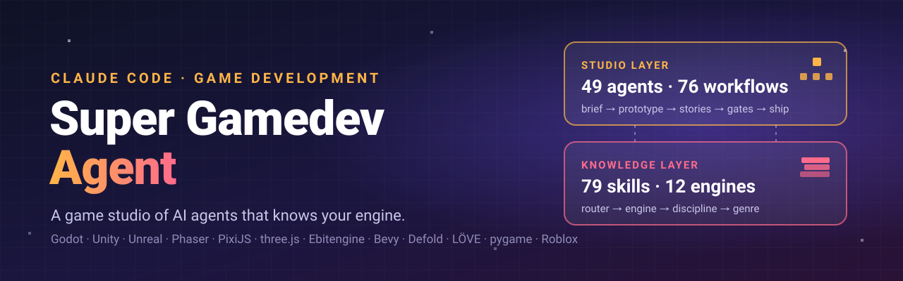

# Super Gamedev Agent

<p align="center">
  <a href="https://lwz7512.github.io/super-gamedev-agent/">
    
  </a>
</p>

<p align="center">
  <b><a href="https://lwz7512.github.io/super-gamedev-agent/">Documentation site</a></b> ·
  <a href="https://lwz7512.github.io/super-gamedev-agent/guide/workflow.html">Workflow guide</a> ·
  <a href="https://lwz7512.github.io/super-gamedev-agent/agents/">Agents</a> ·
  <a href="https://lwz7512.github.io/super-gamedev-agent/skills/">Skills</a> ·
  <a href="https://lwz7512.github.io/super-gamedev-agent/library/">Knowledge library</a> ·
  <a href="https://lwz7512.github.io/super-gamedev-agent/vault/">Vault</a>
</p>

<p align="center">
  <a href="https://github.com/lwz7512/super-gamedev-agent/actions/workflows/studio-evals.yml"></a>
  <a href="https://github.com/lwz7512/super-gamedev-agent/actions/workflows/godot-verify.yml"></a>
  <a href="https://github.com/lwz7512/super-gamedev-agent/actions/workflows/asset-forge.yml"></a>
  <a href="https://github.com/lwz7512/super-gamedev-agent/actions/workflows/playtest.yml"></a>
</p>

A Claude Code setup for making games, built in seven layers. Two come from
existing projects: a **studio** of role agents that runs the process, and a
**knowledge library** that knows each engine. Five are added here, so agents
can also play the game, make its assets, learn from playtests, remember what
earlier games taught, and check that it all still fits together.

| Layer | What it gives you | Use it through |
|---|---|---|
| **Studio** · [Claude Code Game Studios](https://github.com/Donchitos/Claude-Code-Game-Studios) | 49 role agents (directors → leads → specialists), 75 workflow skills from idea to release, 15 safety and quality hooks, coding rules, rigor tiers | `/start`, `/prototype`, `/next-step` |
| **Knowledge** · [awesome-gamedev-agent-skills](https://github.com/gamedev-skills/awesome-gamedev-agent-skills) | 79 skills across 12 engines, 15 disciplines, 9 genres and Steam/itch publishing, pinned to current releases (Godot 4.7.2, Unity 6.3 LTS, Unreal 5.8, …), with a router that picks the 2–3 a request needs | `router`, each agent's Knowledge Library |
| **Run-and-verify** | Agents play a Godot game from a scenario: input at exact frames, checks on live nodes, every error, screenshots and a motion filmstrip | `/play-verify` |
| **Asset production** | Art and sound from OpenArt (MCP), ElevenLabs and a built-in synth, cleaned up, checked, imported, viewed in-engine, with a licence ledger | `/make-assets` |
| **Playtest data** | Telemetry, an in-game feedback form, headless bots that find soft-locks, and reports with funnels, drop-off and heatmaps | `/playtest-data` |
| **Studio vault** | Reusable modules and lessons from earlier games, offered to every new one | `/studio-vault` |
| **Evals** | Static integrity checks, every layer's tests, and scored runs of the agent itself | `/studio-evals` |

## How a game moves through it

1. **Start.** `bin/new-game.sh` makes the project; `/start` or "make me a game"
   (`/prototype`) turns an idea into a one-page brief and a first playable build.
2. **Build.** Stories go to specialist agents, who read the right engine skills
   (and the vault's corrections to them) before writing code, and ask before
   writing any file. Before a common system is built, the vault is searched.
3. **Verify.** Each change a player can see is played: `/play-verify` writes a
   scenario from the acceptance criteria, runs it in Godot and looks at the pictures.
4. **Assets.** `/asset-spec` says what is needed; `/make-assets` makes it,
   checks it, imports it and records where it came from.
5. **Playtest.** Bots run first (the monkey finds the soft-locks); then
   people, with telemetry and the F8 feedback form. `/playtest-data` reports
   and routes findings to `/bug-report`, `/balance-check` and `/playtest-report`.
6. **Ship.** `/cut`, `/release-checklist`, the ledger's release check, Steam or itch.
7. **Remember.** `/retrospective` hands lessons to the vault; systems worth
   keeping are harvested. The next game starts with them.

## Requirements

- [Claude Code](https://code.claude.com/docs) and git.
- **Godot 4.5+** for run-and-verify, playtest bots and vault modules (pinned:
  4.7.2). Godot is the most complete route; Unity, Unreal and web games get the
  studio and the knowledge library.
- **Python 3.9+** for the layer tools; **Pillow** for images and charts
  (`bash .claude/scripts/asset-forge.sh setup` makes `.claude/.venv` if you
  have none); **ffmpeg** for OGG/MP3 audio.
- Optional: an **OpenArt** plan with MCP access (Plus or higher for commercial
  use) and an **ElevenLabs** key (`ELEVENLABS_API_KEY`, any paid plan for
  commercial use).

## Start a new game

```bash
git clone git@github.com:lwz7512/super-gamedev-agent.git
super-gamedev-agent/bin/new-game.sh ~/games/my-game godot   # or no engine: pick it later with /start
cd ~/games/my-game && claude
```

Then say **"make me a game"** or run **`/start`**. The new game finds this
template's vault, gets the engine's library skills, and connects the OpenArt
MCP server (sign in once with `/mcp`).

## The layers

### Knowledge library

The 79 library skills are not all switched on at once: Claude lists every
active skill in its context, and past its listing budget descriptions get cut.

```bash
bash .claude/scripts/library.sh status | groups
bash .claude/scripts/library.sh activate godot   # unity, unreal, web, phaser, pixijs, threejs,
                                                 # ebitengine, bevy, pygame, love2d, defold, roblox, workflows
```

`router` and `core` (disciplines, genres, publishing) are always on;
`/setup-engine` activates the engine's group, and the router can read any
inactive skill directly. Where they disagree, the project's pinned engine
version wins over a skill, a vault addendum wins over a library skill, and the
studio's ask-before-writing rule wins over any skill's instructions. With an
engine active, about 125 skills are listed; if Claude starts missing skills,
set `"skillListingBudgetFraction": 0.02` in your user settings.

**Engine coverage:** Godot, Unity, Unreal and Web get the full studio pipeline
plus the library. Ebitengine, Bevy, Defold, LÖVE, pygame and Roblox get the
library and the engine-agnostic workflow (`engine.code_root` set,
`engine.name` unset).

### Run-and-verify (Godot) · [reference](.claude/docs/godot-verify.md)

```json
{"name": "jump", "seed": 7, "steps": [
  {"at": 70, "action": "jump", "hold": 8},
  {"at": 72, "expect": "position.y < 210", "node": "Player", "within": 30, "label": "jump clears 80px"},
  {"at": 0,  "always": "position.y < 700", "node": "Player", "for": 240, "label": "never falls through the floor"},
  {"at": 90, "shot": "apex"}],
 "filmstrip": {"from": 66, "every": 4, "count": 12}}
```

```bash
bash .claude/scripts/godot-verify.sh install && bash .claude/scripts/godot-verify.sh run tests/scenarios/jump.json
bash .claude/scripts/godot-verify.sh determinism tests/scenarios/jump.json
```

The harness is added for each run through a temporary `override.cfg`, so
`project.godot` is never edited. Results are pass, fail or not assessed, never a
guess: headless runs report screenshots as not assessed instead of hanging, and
parse errors the engine's logger misses are caught from the log.

### Asset production · [reference](.claude/docs/asset-forge.md)

| Source | What | How |
|---|---|---|
| [OpenArt](https://openart.ai/mcp/) | sprites, tiles, icons, UI art | official MCP server (`.mcp.json`, pre-approved); results come in with `ingest` |
| [ElevenLabs](https://elevenlabs.io) | sound effects, voice lines | REST; every paid call is shown first and needs your yes |
| sfxr synth | retro and prototype SFX | local, free, repeatable by seed |
| placeholders | greybox sprites | local, free; the release check fails while any remain |

```bash
bash .claude/scripts/asset-forge.sh add slime --kind image --category enemy --prompt "green slime, side view"
bash .claude/scripts/asset-forge.sh ingest <openart-url> --id slime --provider openart --model <model>
bash .claude/scripts/asset-forge.sh normalize slime && asset-forge.sh qa && asset-forge.sh sheet
bash .claude/scripts/asset-forge.sh godot      # import + in-engine gallery for godot-verify.sh
bash .claude/scripts/asset-forge.sh ledger check --release
```

Cleanup removes the flat key-colour background (or a fake checkerboard),
cleans the edge fringe, fits, anchors and palette-locks each sprite; sounds are
trimmed, faded, levelled (measured after encoding, since lossy codecs overshoot)
and loop seams closed. The ledger writes `assets/provenance.yaml` and enforces
each provider's commercial-use terms when `project.goal` is to sell.

### Playtest data · [reference](.claude/docs/playtest-data.md)

```bash
bash .claude/scripts/playtest.sh install --playtest        # Telemetry autoload + F8 feedback form
bash .claude/scripts/playtest.sh simulate monkey --runs 200 --watch Player:position
bash .claude/scripts/playtest.sh collect                   # receive testers' sessions
bash .claude/scripts/playtest.sh report                    # Markdown + charts + threshold checks
```

Telemetry writes one local file per session (plus optional upload): errors,
frame times, crashes, scene changes and your own events. Release builds record
nothing without the player's consent. Bots run headless, in parallel and
repeatable by seed; a watchdog ends any run that stops making progress, and
runs that fall out of the level are counted. Reports cover funnels, level
completion and deaths, death heatmaps, grouped errors, frame-time percentiles,
feedback, and where bots got stuck.

### Studio vault · [reference](.claude/docs/studio-vault.md)

```bash
bash .claude/scripts/vault.sh search save                 # before building a common system
bash .claude/scripts/vault.sh add save-slots              # install; modules.lock.json tracks the version
bash .claude/scripts/vault.sh harvest combo systems/combo --description "..."   # keep what worked
bash .claude/scripts/vault.sh verify combo                # install into an empty project, run its tests
bash .claude/scripts/vault.sh lessons --skill play-verify
```

Modules carry their autoloads and input actions, with their `res://` paths
made relocatable; updates never overwrite local edits, and improvements can be
pushed back. Lessons record what happened, the evidence and what to do next
time; promoted lessons become **addenda** that correct a library skill without
forking it. It ships with the `save-slots` module and seven lessons learned
while building this template.

### Evals · [reference](.claude/docs/evals.md)

```bash
bash .claude/scripts/evals.sh static              # 11 integrity checks (CI runs them on every push)
bash .claude/scripts/evals.sh selftests --godot   # every layer's test suite
bash .claude/scripts/evals.sh behavior            # 8 scored Claude runs: prints the plan and cost cap; add --yes
```

Static checks catch the joints breaking: an agent naming a renamed skill, a
lost router patch, a missing hook script, a broken doc link, an inconsistent
vault. Behaviour evals run Claude Code on throwaway games and score what it
did: which skills it loaded, whether it asked before writing, whether it left
a paid call's `--yes` to you.

## Keeping up to date

```bash
bin/update-upstream.sh            # what changed in both upstream projects
bin/update-upstream.sh --library  # replace the vendored library, re-validate, run the static evals
```

The library is an unmodified copy, so it is replaced wholesale. The studio
base is merged by hand.

<details>
<summary>Files this template changes or adds in the studio base</summary>

- `CLAUDE.md`: title, the layer table and the layer sections
- `.claude/agents/*.md`: a **Knowledge Library** section in 44 agents (with vault addenda), plus
  **Run and Verify** (9), **Asset Production** (4) and **Playtest Data** (8) sections
- `.claude/skills/setup-engine/SKILL.md`: §9.5 (library activation, the Godot harness)
- `.claude/skills/asset-spec`, `playtest-report`, `retrospective`: a handoff line in their last section
- `.claude/docs/run-and-observe.md`, `skills-reference.md`, `docs/WORKFLOW-GUIDE.md`: pointers to the layers
- `.claude/scripts/skill-lint.sh`: `all` skips library copies; `.claude/hooks/session-start.sh`: library and vault briefs
- `.claude/settings.json`: `enabledMcpjsonServers: ["openart"]`; `.gitignore`: library, `bin/`, layer outputs
- new: `.claude/library/`, `.claude/scripts/{library,godot-verify,asset-forge,playtest,vault,evals}.sh` and their
  packages, `.claude/engines/godot/{verify,telemetry}/`, five skills, five docs, `.claude/evals/`, `vault/`,
  `.mcp.json`, `bin/`, `site/`, `UPSTREAM.lock`, six workflows in `.github/workflows/`
- moved: the studio's own README is `docs/CCGS-README.md`

</details>

## Checks

```bash
bash .claude/scripts/evals.sh all --godot      # static integrity + every layer's self-tests
bash .claude/scripts/skill-lint.sh all         # studio skills
bash .claude/scripts/agent-check.sh            # studio agents
```

## License

Studio layer: MIT, © Donchitos (`LICENSE`). Knowledge library: Apache-2.0,
© gamedev-skills contributors (`.claude/library/LICENSE`, `.claude/library/NOTICE`),
included unmodified.
